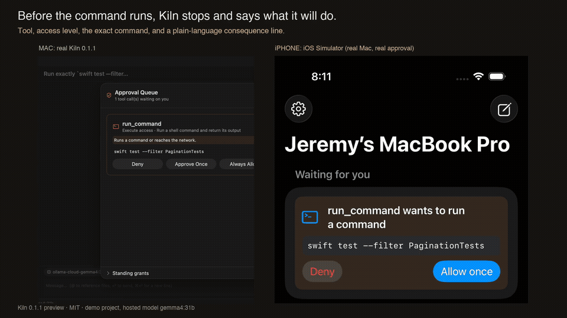
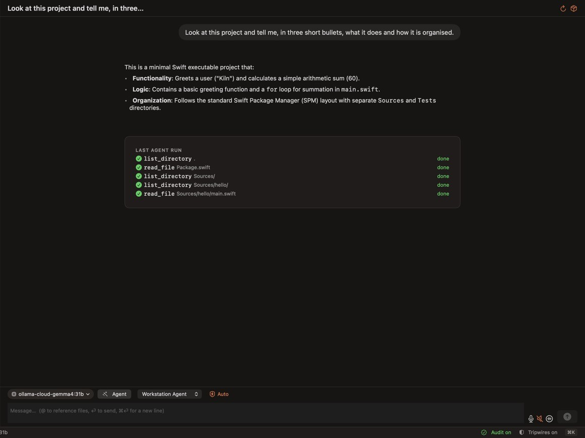
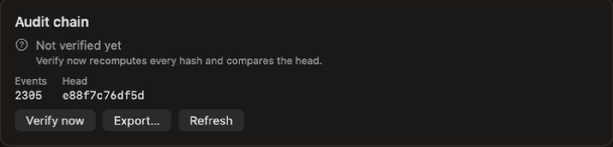
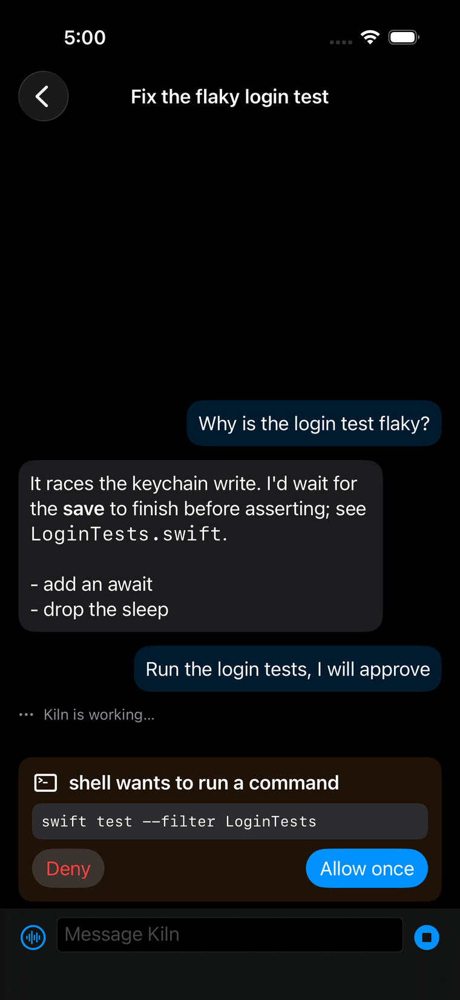

<p align="center"></p>
<h1 align="center">Kiln</h1>
<p align="center"><strong>One native Mac workspace. Many ways to make.</strong><br>AI agents · development · reverse engineering · model experimentation · browser, devices and media</p>
<p align="center"><a href="https://github.com/noktirnal42/Kiln/releases">Download the preview</a> · <a href="https://noktirnal42.github.io/Kiln/">Website</a> · <a href="https://github.com/noktirnal42/Kiln/wiki">Wiki</a> · <a href="docs/GETTING-STARTED.md">Get started</a> · <a href="docs/KNOWN-ISSUES.md">Known issues</a> · <a href="https://github.com/noktirnal42/Kiln/issues">Help build it</a></p>
<p align="center"><br><sub>Real Kiln 0.1.1 on the Mac; the phone is the iOS Simulator companion answering a real approval. Preview software.</sub></p>
<p align="center">  </p>

Kiln is a native macOS workstation, written in Swift and SwiftUI, where an AI agent and a set of professional tools share one foundation. You converse with a model in one window, and the same agent can read and edit code, take a binary apart, train a small model, browse the web, drive a simulator or process media, with every consequential step passing through approvals and a tamper-evident audit record.

**Kiln is early-stage software.** It has real, verified capabilities and substantial unfinished areas. It does not replace Xcode, Ghidra or a production model platform. This README describes what is built; anything planned is under [Roadmap](#roadmap) and is not claimed as shipped.

## Contents

[What Kiln is](#what-kiln-is) · [Screenshots](#screenshots) · [Activities](#activities) · [Agent and MCP integration](#agent-and-mcp-integration) · [Providers](#providers) · [Safety model](#safety-model) · [Install](#install) · [Build from source](#build-from-source) · [Documentation](#documentation) · [Roadmap](#roadmap) · [Contributing](#contributing) · [License](#license)

## What Kiln is

- **One window, one conversation.** Chat opens in the center; Browser, Maps, Devices, Media and News can appear beside it on wider windows. Develop and Analyze keep a larger workspace with a compact chat panel. The sidebar provides projects, conversations and scheduled tasks; the toolbar and Work menu open activities.
- **Agents with real tools.** More than 200 tools (file, shell, Git, development, reverse-engineering, Model Lab, browser, device, media, maps, news, mail, messages, calendar, notes, drives, research, GitHub and opt-in computer use) run through shared services, policy gates and approvals. To save context, a run starts with the basics and the agent loads the rest by asking (`kiln_tool_search`).
- **Bring your models.** Apple Foundation Models, MLX, Ollama (local and cloud), NVIDIA NIM, OpenRouter and any OpenAI-compatible endpoint, with keys in the macOS Keychain.
- **Supervised by design.** Ask, Auto and Bypass approval modes, a behavior monitor, tripwires and a hash-chained audit log you can verify from the app.
- **Take it with you.** Talk to the agent, hear replies, and approve tool calls from an iPhone or Apple Watch companion (built from source) over an encrypted link.
- **Open.** Specifications, implementation and tests are in this repository.

## Screenshots

<p align="center"></p>
<p align="center"><sub>Agent: every tool call of a run is listed, here with the Workstation Agent profile.</sub></p>

<p align="center"></p>
<p align="center"><sub>Audit: the chain of recorded events can be re-verified on demand.</sub></p>

<p align="center"></p>
<p align="center"><sub>Companion: an approval answered from the iPhone app (iOS Simulator capture).</sub></p>

## Activities

Activities have registry-defined shortcuts (⌘1 to ⌘9, then ⌘0), and the registry in [`Core/Registry/`](Core/Registry/) is the single place an activity is declared.

| Shortcut | Activity | What it is for | Honest limits |
|---|---|---|---|
| ⌘1 | **Home** | Overview, a get-started checklist, and a card for each activity grouped as Work, Communication, and Files and knowledge | Overview only |
| ⌘2 | **Agent** | Chat with a model, with tools; compaction, a context meter, a per-model reasoning control, tools loaded on demand, edit and resend, file-name chips, voice | Small local models often fail tool use; on-demand tool loading was seen working with one hosted model |
| ⌘3 | **Swarm** | Give a goal to a team of agents (planner, parallel workers, blockers, shared bus) | No top-level tool yet to create or cancel a run from the agent |
| ⌘4 | **Develop** | Editor, terminal, Git, search, build/test/run, LLDB launch debugger, MCP servers and the Kiln MCP server | A capable editor, not Xcode: no previews, debugger attach or non-Swift/C language servers |
| ⌘5 | **Analyze** | Reverse engineering: import, strings, Mach-O inspection, Ghidra and radare2 engines, decompiler, xrefs, crypto scan, package downloader | Ghidra is separate software you install; the cipher classifier is a placeholder |
| ⌘6 | **Lab** | Datasets, models, experiments, Create ML and MLX training, LoRA, distillation, evaluation, export | Full GUI lifecycle and export coverage still open |
| ⌘7 | **Audit** | What agents did, and whether the record is intact | Agents cannot yet query the audit record |
| ⌘8 | **Browser** | Tabbed WebKit browser the agent can read and drive; identifies itself as Safari, with fullscreen and click-free playback, so streaming sites accept it | Sign-in, autofill and passkeys are unverified; no cloud-gaming service has been confirmed to start yet, and voice chat in a game has no microphone prompt; see [browser authentication](docs/18-BROWSER-AUTHENTICATION.md) |
| ⌘9 | **Devices** | iOS simulators and Android emulators: boot, view, install, launch, logs, record | Apple simulator input is not possible through `simctl`; Windows/Linux is design only |
| ⌘0 | **Media** | Viewer for video, images and audio; text to speech, speech to text, image generation hooks | Image generation needs Apple Image Playground or a configured endpoint (endpoint path unverified) |
| — | **Images** | Local SD-Turbo generation, history and model catalog; optional external engines | SDXL and external-engine generation remain unverified; see [Image Studio](docs/18-IMAGE-STUDIO.md) |
| — | **Maps** | MapKit, USGS Topo, historical catalog, pins and driving directions | Development build; location and routes need live QA |
| — | **News** | ModernReader directory, subscriptions, combined stories and RSS/Atom/JSON feeds | Development build; subscriptions are local and entries are session-only |
| — | **Mail** | Add an account with name, address and password (servers are found automatically and the sign-in is checked before saving), then read, reply and compose; agent tools to list and read | Development build; the empty state was seen on screen, but it has been tested only against scripted local servers, not a real provider. No offline cache, search or folder actions. Outlook.com, Microsoft 365 and STARTTLS-only providers need a browser sign-in or STARTTLS, which is not supported yet |
| — | **Contacts** | Read-only lookup in your Contacts; completes addresses in Mail | Development build; tested with a fake contact list only, and not yet seen with real contacts. Needs your macOS permission |
| — | **Messages** | Conversations from your Messages history, threads that refresh, and sending through the Messages app | Development build. Reading needs Full Disk Access and sending needs Automation permission; Apple documents neither interface, so macOS updates can break it. Sending goes to each conversation by its own id (iMessage, SMS and groups) and a failure is shown in red. Delivery cannot be confirmed. Tested against a fixture database and fake senders; no real text has been sent from it yet |
| — | **Calendar** | Next 7 days of events and open reminders; agents can add an event or reminder after approval | Development build; reading events and reminders was seen working against real data in the installed build (2026-11-12), creating one has not been tried. No edit or delete |
| — | **Research** | A library of sources with notes and tags, citations in APA, MLA and BibTeX, DOI lookup through Crossref, and a PDF reader that highlights and saves a new annotated copy | Development build; scanned PDFs have no text (no OCR); the empty library was seen on screen and a real DOI lookup was run, but the PDF reader's highlight and save buttons are not yet seen |
| — | **Cloud Drives** | Browse and search the names of iCloud Drive, Google Drive, Dropbox and OneDrive folders that their own apps sync to this Mac; read text files; copy files in and out | Development build. Kiln never signs in to a cloud service; online-only files are not read; macOS may ask for folder access; the empty state was seen on screen, and no real drive folder has been browsed yet |
| — | **Notes** | Recent notes, search, read, and add a new note in Apple Notes by driving the Notes app | Development build. Needs Automation permission; Apple documents no data API so it can change with macOS; creates only, never edits or deletes; locked notes cannot be read; the permission screen was seen on screen, and it has not been run against real notes |
| — | **Slack** | Channels, direct messages and history of your Slack workspace, and posting with your approval, using a token you create in your own Slack app and paste into Kiln (kept in the Keychain, never shown again or given to a model) | Development build, tested only against a stub of the Slack API: not seen on screen and not tried against a real workspace. Polls every 15 seconds; no real-time events, search, files or reactions; refuses `@channel`, `@here` and `@everyone`; other chat services (Discord, Teams) are not built |
| — | **GitHub** | Pull requests, CI runs and issues of the open project, read-only, through the `gh` sign-in already on your Mac | Development build; no comments, reviews or merges. Seen on screen in a folder that is not a repository, not yet against a live repository |

Details for each are in the [wiki](https://github.com/noktirnal42/Kiln/wiki) (source in [`docs/wiki/`](docs/wiki/Activities.md)) and on the [website](https://noktirnal42.github.io/Kiln/activities.html).

## Product direction

See the [feature and Maps roadmap](docs/21-EVERYTHING-APP-ROADMAP.md) and [competitive research](docs/22-PARITY-RESEARCH-2026-11-10.md) for reliability priorities, cross-activity workflows, and a proposed MapKit and USGS topographic and historical-map activity. Future features in those roadmaps remain proposals; the current Maps and News development scope is described in [Maps and News](docs/23-MAPS-AND-NEWS.md).

## Agent and MCP integration

Application services are registered as ordinary tools with a declared permission level (read, write or execute). The in-app agent and Kiln's own MCP server use the same registry and gates.

- **Agent profiles:** Research Assistant (read-only), Coding Agent, and Workstation Agent (adds `re_*`, `lab_*`, `ide_*`, `browser_*`, `device_*`, `media_*` and the other module tools).
- **Tools on demand:** when all tool definitions would use more than a tenth of the model's context window (they are about 21,000 tokens), a run starts with the file, search, shell, Git and web tools plus one tool, `kiln_tool_search`. The agent searches by what it needs ("email", "calendar") and the matching tools are added for the rest of the run; calling a tool that is not loaded loads it and returns its arguments. Permissions and approvals are unchanged. A window too small even for the basics is trimmed to fit. Swarm workers still get their tools up front.
- **Kiln as an MCP server:** Develop → MCP → Start. Loopback only, bearer-token protected, with reads free and everything else waiting for approval in Kiln. External calls are audited as "External: <client>".
- **Kiln as an MCP client:** it reads, never copies, MCP servers and skills already configured for Claude Code, Codex and OpenCode. Each imported server still needs "Approve & Connect".
- **Tool families:** `re_*` (reverse engineering), `lab_*` (Model Lab), `ide_*` (Develop), `browser_*`, `device_*`, `media_*`, `image_*`, `maps_*`, `news_*`, `swarm_*`, `kiln_*` (memory, commands, schedules, checkpoints, usage, round limit), Git, search, shell and file tools, `list_skills` / `read_skill`, and opt-in `computer_use`. Development builds add `mail_*`, `contacts_*`, `messages_*`, `calendar_*` / `reminders_*`, `notes_*`, `drive_*`, `pdf_*` / `library_*` and `github_*` and `slack_*`. Reading mail, messages, notes, Slack and calendar is gated by macOS permissions; sending a mail or text and creating a calendar event or note need your approval of the exact recipients and text, and text from other people is labelled untrusted.
- **Spotlight:** conversations can be added to Spotlight (Settings: Off, which is the default, Titles only, or Titles and text). Secrets are redacted, choosing Off removes everything Kiln added, and a result opens that conversation. Unit-tested; a real Spotlight search has not been tried.
- **Shortcuts:** Kiln offers App Shortcuts to open any activity, open a website, or put a question in the message box ("Ask Kiln").

The [agent capability matrix](docs/13-AGENT-CAPABILITY-MATRIX.md) lists what is covered and, as importantly, the registry gaps that have no agent tool yet.

## Providers

Chat was verified with real calls against each provider below on 2026-11-01 (see [current state](docs/11-CURRENT-STATE.md)). Provider connectivity is not evidence of reliable agent behavior.

| Provider | Chat | Tool use | Notes |
|---|---|---|---|
| Apple Foundation Models | yes | no | On-device |
| Ollama (local) | yes | yes | Only models the running server knows |
| Ollama Cloud | yes | yes | Some models need paid credits |
| NVIDIA NIM | yes | yes | Some models are slow to first token |
| OpenRouter | yes | yes | Free models come and go |
| Custom endpoint | yes | yes | Any OpenAI-compatible URL |
| MLX (local) | yes | no | Models from the shared Hugging Face cache |

An Apple Private Cloud Compute provider is **in development and untested** (it needs macOS 27, a managed entitlement and a qualifying distribution route); do not assume it works. See [Apple capabilities](docs/20-APPLE-CAPABILITIES.md).

## Safety model

- **Approvals.** Reads run freely. Writes, commands and network calls open an approval sheet. Modes: **Ask** (default), **Auto** (routine, in-project, non-destructive calls only) and **Bypass** (red, confirmed first). A mode answers once, never creates a standing grant, and resets to Ask whenever Kiln launches. "Always Allow" standing grants are made at the Mac and are revocable.
- **Policy and monitoring.** Two policy gates, a behavior monitor and tripwires sit around every agent and swarm tool call.
- **Audit chain.** Agent runs, decisions and tool results are recorded in a tamper-evident hash chain that Audit → Verify now recomputes. Every human or mode answer is logged with how it was given.
- **Not sandboxed.** Since 2026-11-02 Kiln is **not** App Sandboxed, so the agent can run real git, package managers and shells. The hardened runtime and notarization still apply. File tools are confined to the project root, but `run_command` is not: a command can touch anything your user account can. Treat approvals as the boundary.
- **Secrets.** Provider keys live in the Keychain. Browser tools refuse password, card and one-time-code fields; page content is labelled untrusted.
- **Remote control.** Phone and watch can allow once or deny; they cannot grant standing access or change settings. Frames are ChaCha20-Poly1305 encrypted. See [remote control](docs/14-REMOTE-CONTROL.md).

## Install

A Developer ID signed, notarized and stapled **preview** build is on the [Releases page](https://github.com/noktirnal42/Kiln/releases). Read each release's notes for what was and was not verified. It is a preview, not a stable release, and there is no in-app updater: download a new build and replace the app (data lives in `~/Library/Application Support/Kiln`). The iPhone and Apple Watch apps are not in the download; build them from [`Companion/`](Companion/) with your own signing team. The published preview (0.1.1, 2026-11-03) is far behind `main`. Builds made from `main` identify themselves as **0.2.0 (3)** (see Settings, About) because `project.yml` is already versioned for the next preview; no 0.2 release has been published, so 0.1.1 is the only download. The published preview it predates Maps, News, Images and every communications and knowledge activity (Mail through GitHub), the on-demand tool loading and most of the interface work. Build from source to try them; the release notes of a future preview will list what it contains.

## Build from source

Requirements: a Mac, Xcode 27 or newer with matching command-line tools, and [XcodeGen](https://github.com/yonaskolb/XcodeGen). Apple silicon is recommended (MLX workflows need it). The generated Xcode project is not committed.

```sh
git clone https://github.com/noktirnal42/Kiln.git
cd Kiln
brew install xcodegen  # if needed
xcodegen generate
open Kiln.xcodeproj
```

Select the **Kiln** scheme and your own signing team; `project.yml` is the source of truth and regenerating the project discards Xcode-only edits. To build an unsigned development bundle:

```sh
xcodebuild build -project Kiln.xcodeproj -scheme Kiln \
  -destination 'platform=macOS,arch=arm64' CODE_SIGNING_ALLOWED=NO
```

```sh
# Non-live regression suite
xcodebuild test -project Kiln.xcodeproj -scheme Kiln \
  -destination 'platform=macOS,arch=arm64'
```

Opt-in live QA suites spend provider credits; see [CONTRIBUTING.md](CONTRIBUTING.md). Add API keys only through Settings and never commit them. A [build/run script](script/build_and_run.sh), a [clean-clone walkthrough](docs/GETTING-STARTED.md) and [signing and release notes](docs/RELEASING.md) are included. A clean-checkout build took about six minutes in the walkthrough; first builds download several GB of packages.

**Test status:** the full Mac suite passed 1,063 tests in 216 suites on `main` (`4b647e8`, 2026-11-12, run locally; CI on a hosted macOS runner runs the same suite in about 15 minutes, but GitHub's macOS capacity is sometimes short). Older documents quote earlier counts. A passing suite does not certify every provider, model or workflow.

## Documentation

| Where | What |
|---|---|
| [Website](https://noktirnal42.github.io/Kiln/) | Overview, activities, agent and MCP tools, roadmap |
| [Wiki](https://github.com/noktirnal42/Kiln/wiki) | Task-oriented guides (source in [`docs/wiki/`](docs/wiki/Home.md)) |
| [Current state](docs/11-CURRENT-STATE.md) | What exists, how it was checked, what is open |
| [Known issues](docs/KNOWN-ISSUES.md) | Verification limits and gaps |
| [Agent capability matrix](docs/13-AGENT-CAPABILITY-MATRIX.md) | What agents can and cannot operate |
| [Docs map](docs/DOCS-MAP.md) | Which document is authoritative for what |
| [Specification index](docs/README.md) | Vision, architecture and design specs |

Specifications include future ambitions; they are not feature-completion claims.

## Roadmap

Image studio, the agent platform (slash commands, hooks, memory files, plan mode, checkpoints and rewind, sessions, usage and cost, schedules), Mail, Contacts, Messages, Calendar and Reminders, Notes, Cloud Drives, Research, GitHub, Spotlight indexing and Shortcuts are built and are in the table above with their limits. Several are development builds that have not been tried with real accounts. **What follows is not built.** The full list with per-module bars is in [Parity and beyond](docs/17-PARITY-AND-BEYOND.md).

- **Next, in the order the owner set:** Notification Center and Focus awareness; a menu-bar quick-ask and Share extension; Writing Tools and Services-menu actions; weather and a radar layer on the Maps view; and a document, spreadsheet and presentation studio. The details and acceptance notes are in the [feature roadmap](docs/21-EVERYTHING-APP-ROADMAP.md).
- **Develop and Analyze upgrades (ongoing):** toward an Xcode and Ghidra bar. Much of the Develop and Analyze service layer exists (symbols, references, rename, debugger conditions, control-flow and call graphs, patching, binary diffing); many of the new views have not been seen in the running app.
- **Chat and layout:** a title-bar icon row with a canvas beside the thread, Swarm folded into chat, images sent as pixels to vision models, thread rename, pin and search. See the [chat and layout plan](docs/30-CHAT-MAPS-LAYOUT-PLAN.md).
- **Beyond parity:** evidence ledger and signed run bundles, a Pinboard context tray, saved workflows, closed-loop app analysis, a verifier agent, privacy tiers and local-first routing, and policy as code.
- **Platform work with outside dependencies:** passkeys in the Browser need an Apple entitlement that has been requested and not granted; iCloud sync, push and Private Cloud Compute are not implemented or verified; no dates are promised.

## Contributing

Start with [good first issues](https://github.com/noktirnal42/Kiln/issues?q=is%3Aopen+label%3A%22good+first+issue%22), [help wanted](https://github.com/noktirnal42/Kiln/issues?q=is%3Aopen+label%3A%22help+wanted%22) or the [contribution areas](docs/CONTRIBUTION-AREAS.md). Read [CONTRIBUTING.md](CONTRIBUTING.md) before a pull request: keep changes focused, preserve approval boundaries, and attach evidence (and say what you did not verify). Questions go to [Discussions](https://github.com/noktirnal42/Kiln/discussions); security reports follow [SECURITY.md](SECURITY.md); see [SUPPORT.md](SUPPORT.md) and the [code of conduct](CODE_OF_CONDUCT.md).

Donation account setup is in progress; verified payment links will be added here and on the site when ready.

## License

Kiln is **source-available**, not open source. The source and builds are licensed under the
[PolyForm Noncommercial License 1.0.0](LICENSE), copyright FreeRange Labs: free for personal,
hobby, research, educational and charitable use. **Using Kiln for work or for a business needs a
commercial license**: see [COMMERCIAL-LICENSE.md](COMMERCIAL-LICENSE.md) or write to
freerangelabs@drumnbus.com.

- Releases up to `v0.1.1` were published under MIT and stay MIT for those copies; see [LICENSE-HISTORY.md](LICENSE-HISTORY.md).
- Contributions are accepted under the [contributor agreement](CLA.md).
- The name and logo are not licensed; see [TRADEMARKS.md](TRADEMARKS.md).
- Third-party licenses: [THIRD-PARTY-NOTICES.md](THIRD-PARTY-NOTICES.md). The license does not override the terms of models, datasets or services you use with Kiln.

Respect the licenses and terms of third-party libraries, models, datasets and services; the project's license does not override theirs. Kiln is independent and is not affiliated with Apple, Anthropic, OpenAI or the Ghidra project.
